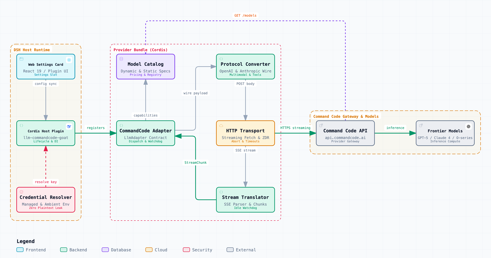

# dsh-commandcode-goat-provider

Direct provider bundle integrating **Command Code GOAT** with **DeepSeek Harness (DSH)** Web profile.

## Overview

This package is a native, external DSH bundle providing first-class access to bleeding-edge reasoning and coding models from the Command Code Provider API (`https://api.commandcode.ai`).

### Key Features

- **Direct Provider Integration**: Connects straight to Command Code Provider API (`/provider/v1/models`, `/provider/v1/chat/completions`, `/provider/v1/messages`) without local proxies or daemon intermediaries.
- **Dual Wire Translation**: Dynamically maps requests and SSE streams between DSH's internal streaming protocol (`StreamChunk`) and OpenAI / Anthropic wire formats based on model family and custom overrides.
- **Dynamic Catalog & Static Fallbacks**: Normalizes live discovery results from `/provider/v1/models` while preserving static capability hints for known models (e.g. `gpt-5.6-luna`, `claude-sonnet-4-6`).
- **Prices in the Picker**: Each picker row shows the model's published input→output price (`$0.20→$1.20`), with free models named `Free`, so a model's cost is visible before the first call. A model whose price is not published shows its name alone.
- **Web Settings Card**: Registers an accessible, localized configuration card under **Settings → Plugins → Configurable** (`llm-commandcode-goat`) with write-only credential staging.
- **Security & Privacy**: API keys are resolved exclusively through DSH's credential store (`ctx.credentials`) or ambient launch environment (`COMMANDCODE_API_KEY`) and are never written to disk, logged, or exposed in the UI. Supports Zero Data Retention (ZDR) routing.

## Configuration

The bundle is configured under the `llm-commandcode-goat` settings namespace:

| Field | Type | Default | Description |
| :--- | :--- | :--- | :--- |
| `apiKeyEnv` | `string` | `COMMANDCODE_API_KEY` | Environment variable name for credential resolution. |
| `baseURL` | `string` | `https://api.commandcode.ai` | Base URL of the Command Code Provider API. |
| `defaultContextWindow` | `number` | `262144` (256K tokens) | Fallback context window capacity for unknown models. |
| `maxTokens` | `number` | `65536` | Maximum completion tokens cap per request. |
| `requestTimeoutMs` | `number` | `60000` (60s) | Timeout for establishing initial HTTP/SSE stream response. |
| `streamIdleTimeoutMs` | `number` | `300000` (5m) | Maximum silence duration between streaming chunks before aborting. |
| `enableZdr` | `boolean` | `false` | When enabled, requests Zero Data Retention from supported providers. |
| `protocolOverrides` | `Array<{ model, protocol }>` | `[]` | Explicit wire protocol mappings (`openai` or `anthropic`). |

## Prices in the model picker

Each row of the composer's model picker appends the catalog price, `$0.20→$1.20` (USD per million tokens, in→out), right-aligned so the figures form one column. A free model is named `Free` instead. The price is read from the same `CATALOG` entry that builds the model description, so the row and the description can never drift apart.

The label is registered on the `conversation.input.model.label` slot. That slot is `single`, and DSH ships its own contribution to it for the DeepSeek-official Flash row (the `1017` release badge); a second registration therefore shadows the first rather than composing with it, which is why this bundle registers at `priority: -1` and reproduces the badge in its own component. Rows belonging to other providers keep their untouched name, and a model the catalog has not curated shows no price at all — a figure is never invented.

The composer trigger and the root-menu value stay name-only: the trigger is a narrow, truncating caption, not a place models are compared. The `/model` slash-command popup is not covered — DSH builds its rows without a slot hook, so that surface still lists names only.

## Quota badge

The session-header badge and the `get_usage` tool show the CommandCode GOAT quota (5-hour / weekly / monthly windows). The snapshot refreshes on each agent step (at most once per `refreshIntervalMs`, default 60000 ms). There is **no automatic switching**: neither quota pressure nor outages change the active route.

Each window row carries its reset countdown. The credits endpoint reports `resetAt` for the 5-hour and weekly windows, but describes the monthly grant only as a remaining balance — no cap, no reset time. The monthly cycle end is therefore read from `/alpha/billing/subscriptions` (`currentPeriodEnd`) in a request parallel to the credits one, the same source the Pi usage extension and the homepi hub use. If that call fails the quota reading is unaffected; only the month row loses its countdown.

The panel lays every row out on one grid — label, bar, countdown, percent — and the header spans the same columns, so a wide countdown or a missing one never shifts the bars or the figures. A window with no reset time keeps an empty countdown cell rather than letting its neighbour move, and the percent holds the right edge. Below 900px the countdown column is dropped and the rest of the alignment is unchanged.

## Architecture & Integration

[](https://hidenobunagai.github.io/dsh-commandcode-goat-provider/)

> 🌐 **[View Interactive Architecture Diagram (GitHub Pages)](https://hidenobunagai.github.io/dsh-commandcode-goat-provider/)**  
> Explore interactive views, route tracing, light/dark themes, and repository source mappings.

- **Host Service**: `src/index.ts` exports a standard Cordis plugin declaring `inject: { llm, attachments }` and registers the `commandcode-goat` adapter, configurable provider metadata, model discovery, and settings listeners.
- **Browser Client**: `src/client/index.ts` exports a CJS lazy module registered via `dsh.client` that injects the configuration card into the `settings.models.provider-card` slot (keyed by the `llm-commandcode-goat` settings namespace, so the card renders inside this provider's card on Settings > Models).
- **Patch Manifest**: `cordis.patch.yml` specifies the single declarative entry row required for DSH deployment profiles. This file is read by `dsh bundle` at deploy time — do not rename or remove it.
- **Model Catalog**: `src/catalog/data.ts` is the single source of truth for all known models; `src/catalog/index.ts` derives pricing, capability, and display maps from it. Add new models there — never in multiple places. See [docs/model-sync.md](docs/model-sync.md) for the sync, version-bump, and publish procedure.

## Development & Verification

```bash
# Run full test suite (unit, conversion, stream translation, card, composition)
bun run test

# Run TypeScript typecheck
bun run typecheck

# Run linter
bun run lint

# Build host ESM and browser client CJS artifacts
bun run build
```

## License

MIT
